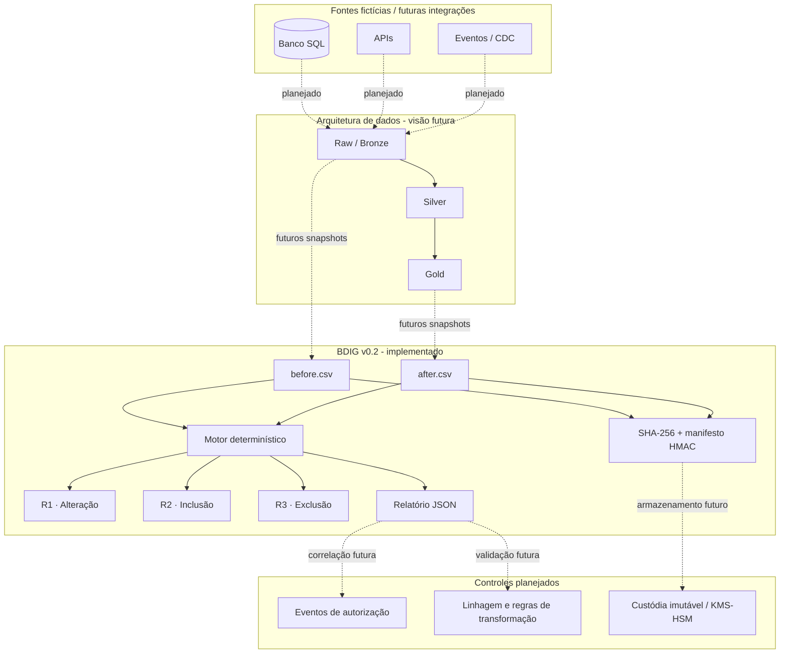

<div align="center">

# 🛡️ Bank Data Integrity Guard
### BDIG · Deterministic Banking Data Integrity

**Auditoria determinística de dados em todas as camadas — independente da tecnologia e do uso de IA**


[Visão geral](#-visão-geral) · [Arquitetura](#-arquitetura-de-referência) · [Metodologia](#-metodologia-de-verificação) · [Execução](#-executando-localmente) · [Roadmap](#-roadmap)

</div>

---

## 🎯 Visão geral

O **Bank Data Integrity Guard (BDIG)** é um projeto de engenharia de segurança de dados para detectar **divergências entre duas fotografias (snapshots)** de registros financeiros. Seu núcleo atual é um comparador determinístico de arquivos CSV sintéticos, com validações de chave e esquema e demonstração de evidências criptográficas.

O objetivo de longo prazo é auditar **dados em qualquer camada de processamento** — origem, ingestão, Raw/Bronze, Silver, Gold, APIs, aplicações, relatórios e entradas/saídas de sistemas de IA — independentemente do fornecedor ou tecnologia. O BDIG busca identificar mudanças inesperadas, violações de contratos e operações não autorizadas, com políticas de bloqueio e revisão humana quando aplicável. **A detecção de uma diferença não prova fraude, comprometimento por IA ou ausência de autorização.**

> **Estado atual — v0.2.0 (POC):** execução local, dados fictícios, sem conexões com instituições financeiras e sem IA/LLM. Conectores, rastreamento de transformações e mecanismos de custódia independente permanecem no roadmap.

## 🧭 Missão: integridade de ponta a ponta, inclusive para IA

O BDIG pretende funcionar como uma **camada externa de confiança**, desacoplada dos motores de processamento e dos modelos de IA. Seu papel é verificar dados e decisões automatizadas **contra regras, contratos, autorizações e evidências independentes**, e não confiar cegamente no resultado produzido por um sistema.

**Escopo futuro:** verificação por camada e entre camadas; linhagem e reconciliação; detecção de perda, duplicidade e alteração de registros; validação de schema, tipos, chaves, totais e regras de negócio; inspeção de entradas e saídas de IA; segregação de funções; quarentena ou bloqueio de ações de alto risco; trilha de auditoria e revisão humana. Cada integração precisará de adaptadores e contratos específicos.

**Limite essencial:** não é possível prometer que uma IA *nunca* erre. A meta de engenharia é reduzir a probabilidade e o impacto de erros, detectar violações verificáveis e impedir ações fora das políticas estabelecidas. A POC v0.2 **não** monitora, controla nem bloqueia sistemas de IA.

## 🧭 Problema e proposta de valor

Em pipelines financeiros, alterações podem resultar de operações legítimas, erros de integração, regras incorretas, falhas operacionais ou atividades maliciosas. Um relatório final isolado não basta para reconstruir o histórico dessas mudanças.

O BDIG propõe um processo reproduzível de **comparação de estados**, **registro de evidências** e, futuramente, **correlação com eventos de execução e autorização**, sem delegar decisões a modelos generativos.

### Princípios de engenharia

- **Núcleo sem IA/LLM:** comparação baseada em regras explícitas, reproduzíveis e testáveis; sistemas com IA poderão ser auditados futuramente.
- **Dados sintéticos:** nenhuma informação real de MAPFRE, Santander, Target ou clientes.
- **Isolamento:** sem conexões bancárias, credenciais corporativas ou operações de pagamento.
- **Linha de base confiável:** no produto futuro, capturada e custodiada independentemente do sistema auditado.
- **Segurança verificável:** evidências devem ser autenticadas; hash isolado não comprova origem ou imutabilidade.
- **Transparência:** separar funcionalidade implementada, demonstrada e planejada.

## 🏗️ Arquitetura de referência



**Importante:** a comparação entre Raw e Gold exige regras de transformação e contratos específicos. Não é correto comparar diretamente registros de granularidades diferentes como se fossem snapshots equivalentes.

Documentos complementares: [arquitetura](docs/architecture.md), [metodologia](docs/methodology.md), [segurança](docs/security.md), [conectores](docs/connectors.md) e [plano de implementação](docs/implementation-plan.md).

## 🔎 Metodologia de verificação

| Regra | Pergunta | Critério inicial da POC | Resultado |
|---|---|---|---|
| **R1 — Alteração** | Um registro mudou? | Mesma chave; fingerprint dos campos diferente | Chave modificada |
| **R2 — Inclusão** | Surgiu um registro? | Chave presente apenas no snapshot posterior | Chave incluída |
| **R3 — Exclusão** | Um registro desapareceu? | Chave presente apenas no snapshot anterior | Chave excluída |
| **R4 — Transformação** | Uma transformação mudou indevidamente os dados? | Contratos e linhagem por camada | **Planejado** |

**Fluxo metodológico:** definir contrato → obter linha de base → validar esquema e unicidade → autenticar evidências disponíveis → comparar snapshots → registrar divergências → investigar legitimidade com logs e autorizações (futuro).

### Demonstração com transações fictícias

| Transação | Antes | Depois | Classificação |
|---|---|---|---|
| TX001 | R$ 100,00 · SETTLED | R$ 100,00 · SETTLED | Sem alteração |
| TX002 | R$ 200,00 · PENDING | R$ 250,00 · PENDING | **R1** |
| TX003 | R$ 300,00 · SETTLED | Ausente | **R3** |
| TX004 | Ausente | R$ 150,00 · PENDING | **R2** |

Esses valores são **exclusivamente sintéticos**. A POC compara campos textuais de CSV; ainda não implementa um modelo monetário baseado em `Decimal`.

## 🧩 Componentes e maturidade

| Componente | Situação | Observação |
|---|---|---|
| `src/bankguard/core.py` | **Implementado** | Leitura CSV, fingerprint e regras R1–R3 |
| `src/bankguard/evidence.py` | **Implementado (POC)** | Hash SHA-256 e autenticação HMAC de manifesto |
| `src/bankguard/cli.py` | **Implementado** | Interface de linha de comando |
| `config/contract.example.json` | **Exemplo** | Contrato declarativo; integração completa pendente |
| `tests/test_core.py` | **3 testes definidos** | Regras, fingerprint e chave ausente |
| `tests/test_evidence.py` | **5 testes definidos** | Captura, adulteração, sobrescrita e chave curta |
| Raw/Bronze, Silver, Gold e outras camadas | **Planejado** | Auditoria de transformações, contratos e reconciliação entre camadas |
| Governança de dados utilizados por IA | **Planejado** | Verificação de entradas, saídas, políticas e autorizações; sem garantia absoluta de ausência de erros |
| SQL, Spark/PySpark, Kafka, Airflow, APIs e CDC | **Planejado** | Nenhum conector operacional declarado |
| Snapshots consistentes, WORM, KMS/HSM | **Planejado** | Necessários para custódia robusta |

A existência dos oito testes foi identificada no inventário; a execução deve ser comprovada no ambiente atual antes de atualizar um selo para **8 passando**.

## 🗂️ Estrutura do repositório

```text
bank-data-integrity-guard/
├── .github/workflows/ci.yml
├── config/contract.example.json
├── docs/
│   ├── architecture.md
│   ├── commercial.md
│   ├── connectors.md
│   ├── implementation-plan.md
│   ├── methodology.md
│   ├── roadmap.md
│   └── security.md
├── examples/
│   ├── before.csv
│   └── after.csv
├── scripts/
│   ├── audit-project.ps1
│   ├── demo-windows.ps1
│   └── setup-windows.ps1
├── src/bankguard/
│   ├── __init__.py
│   ├── cli.py
│   ├── core.py
│   └── evidence.py
├── tests/
│   ├── test_core.py
│   └── test_evidence.py
├── .gitignore
├── pyproject.toml
└── README.md
```

## 💻 Executando localmente

**Pré-requisitos:** Windows, Python 3.11+ e PowerShell 7 recomendado. O projeto não requer acesso a sistemas bancários. **Atenção:** o script `setup-windows.ps1` da v0.2 exige o comando `py`; apenas `python` no PATH não é suficiente para esse script.

**Se o PowerShell bloquear o script por assinatura:** confira `Get-ExecutionPolicy -List` e a procedência do arquivo. Se houver marca de origem da internet e você tiver revisado o script, use `Unblock-File .\scripts\setup-windows.ps1`. Políticas corporativas que exigem assinatura devem ser respeitadas; nesse caso, prefira a instalação manual abaixo. Não desabilite globalmente as proteções de execução.

```powershell
# Abra a pasta que contém pyproject.toml
cd .\bank-data-integrity-guard

# Configure o ambiente e execute os testes
pwsh -NoProfile -File .\scripts\setup-windows.ps1

# Execute a demonstração com dados fictícios
pwsh -NoProfile -File .\scripts\demo-windows.ps1
```

Se estiver usando apenas Windows PowerShell 5.1, prefira executar os scripts de demonstração com `pwsh` 7, conforme os pré-requisitos atuais.

### Execução manual (sem executar scripts `.ps1`)

Caso o script seja bloqueado ou o launcher `py` não esteja disponível, instale o Python 3.11+ e, no terminal PowerShell, execute:

```powershell
python --version
python -m venv .venv
.\.venv\Scripts\python.exe -m pip install -e .
.\.venv\Scripts\python.exe -m unittest discover -s tests -v
.\.venv\Scripts\python.exe -m bankguard.cli compare examples/before.csv examples/after.csv --key transaction_id --output artifacts/report.json
```

**Nota:** se `python --version` abrir o atalho da Microsoft Store, instale Python de verdade e reabra o terminal. Não execute comandos de teste até o interpretador funcionar.

**Saída esperada do exemplo:** TX002 modificada, TX004 incluída, TX003 excluída e TX001 inalterada. O resultado deve ser confirmado executando os comandos na versão publicada.

### Evidências criptográficas: escopo e limitações

A demonstração usa SHA-256 para identificar alterações no conteúdo do CSV e HMAC para autenticar o manifesto **enquanto a chave secreta permanecer confiável**. O script de demonstração cria uma chave temporária e a descarta ao finalizar; portanto, os manifestos não permanecem verificáveis em execuções posteriores sem essa chave.

**Não há**, nesta versão, garantia de imutabilidade, assinatura independente, timestamp confiável ou captura transacionalmente consistente. O sistema não prova autoria da alteração nem identifica automaticamente fraude.

## 🧪 Qualidade e testes

```powershell
.\.venv\Scripts\python.exe -m unittest discover -s tests -v
```

Os testes definidos cobrem comparação de snapshots, fingerprint, validação de chave, verificação de manifesto, adulteração de dados e manifesto, proteção contra sobrescrita e rejeição de chave curta. O workflow de CI está em `.github/workflows/ci.yml`; seu funcionamento no GitHub deverá ser verificado após a publicação.

## 🔐 Modelo de segurança

**Ameaças consideradas:** alteração indevida de registros, exclusão ou inclusão inesperada, manipulação de artefatos, erros de pipeline e uso indevido de permissões.

**Controles atuais:** validações determinísticas locais, comparação por chave, checagem de esquema, hash e HMAC demonstrativos.

**Controles ainda necessários:** captura independente, logs de eventos e autorizações, controle de acesso por menor privilégio, custódia imutável, KMS/HSM, gestão de chaves, observabilidade e validação de consistência temporal.

> O BDIG **não executa pagamentos, não acessa contas bancárias e não é um sistema homologado para produção**. Qualquer piloto empresarial exigirá autorização formal, avaliação de riscos e requisitos de segurança e conformidade aplicáveis.

## 🗺️ Roadmap

| Fase | Entrega | Status |
|---|---|---|
| **0.1–0.2** | Comparação CSV R1–R3 e evidências HMAC locais | Protótipo implementado |
| **0.3** | Relatórios estruturados, contratos versionados e cenários de teste ampliados | Planejado |
| **0.4** | Simulador bancário sintético Raw/Bronze → Silver → Gold | Planejado |
| **0.5** | R4: linhagem, regras de transformação e reconciliação por camada | Planejado |
| **0.6** | Conectores de leitura para SQL, APIs e pipelines | Planejado |
| **0.7** | Integrações Spark, Kafka, Airflow e CDC | Planejado |
| **1.0** | Custódia independente, trilha auditável e validação de segurança | Meta futura, sujeita a critérios de aceite |

Consulte [roadmap detalhado](docs/roadmap.md) e [plano por fases](docs/implementation-plan.md).

## 🏦 Aplicações potenciais

A solução é concebida para, futuramente, apoiar equipes de engenharia de dados, segurança, controles internos e auditoria de instituições financeiras em processos de reconciliação, monitoramento de integridade e investigação de mudanças. **Não há implantação, homologação ou parceria declarada com bancos ou seguradoras.**

## 🤝 Contribuições e governança

O projeto encontra-se em fase experimental. Antes de aceitar contribuições externas, serão definidos fluxo de revisão, política de divulgação de vulnerabilidades, critérios de testes e responsabilidades de manutenção. Nunca abra issues contendo credenciais ou dados financeiros reais.

## ⚖️ Licença, propriedade intelectual e uso comercial

**Licença ainda não definida.** A disponibilidade pública do código não significa concessão automática de direitos de reutilização, redistribuição ou comercialização. Antes da distribuição comercial, será necessário definir licença, autoria, titularidade, política de segurança e requisitos contratuais/regulatórios.

---

<div align="center">

**BDIG · Integridade verificável. Evidências reproduzíveis. Segurança por desenho.**

*Projeto experimental de engenharia de segurança de dados — sem IA e com dados sintéticos.*

</div>
