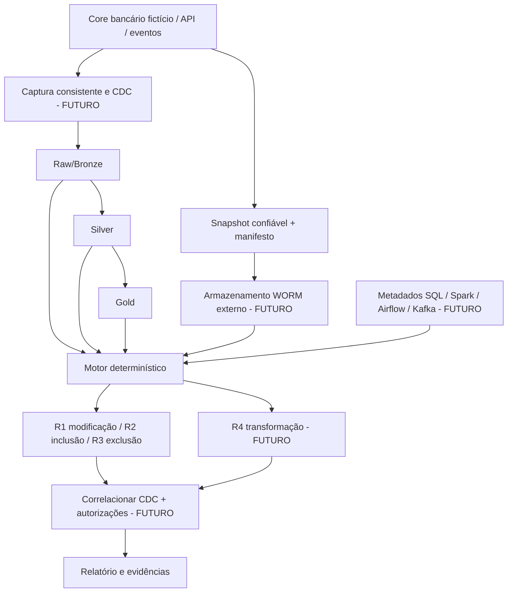

# Arquitetura de referência — fictícia, sem acesso bancário

## Limites e ameaças

* **Já implementado:** CSV local, detecção R1-R3, verificação de schema, hashing SHA-256 e manifesto HMAC, sem dependências runtime externas.
* **Não implementado:** R4, captura transacional consistente, CDC, armazenamento WORM, integração com banco/API, cadeia de custódia, autorização corporativa, alerta em tempo real.
* **Condição de confiança:** a referência deve ser capturada por mecanismo independente e validada com chave protegida separadamente. HMAC local sozinho não prova imutabilidade, autenticidade temporal ou identidade do operador.
* **Limite do snapshot:** mudança que ocorre e é revertida entre fotografias passa despercebida sem CDC/audit log.
* **Limite do diff:** divergência não prova adulteração; evento legítimo requer vínculo com razão de negócio e autorização.
* **Risco operacional:** não armazenar CPFs, nomes, contas reais, segredos, dumps ou dados corporativos no repositório.
